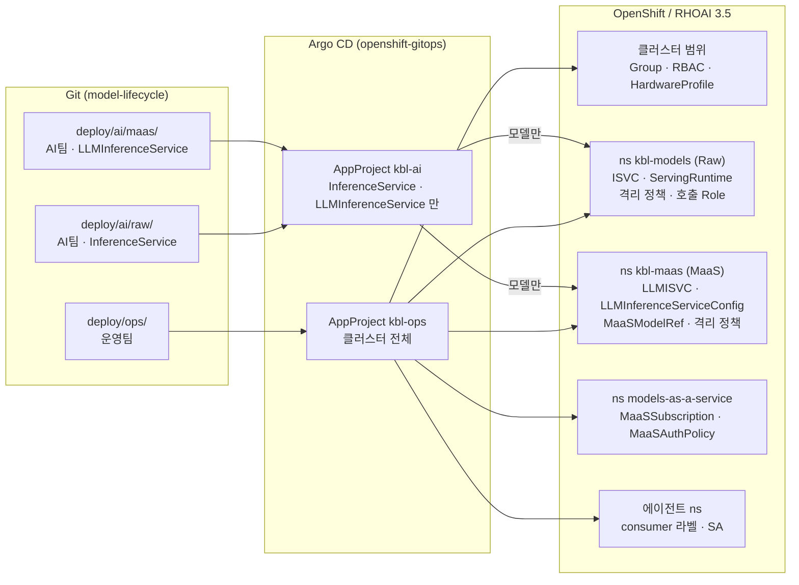
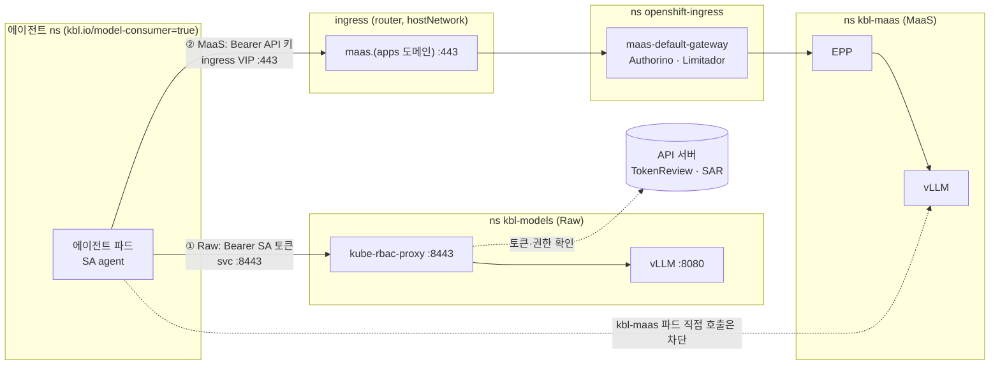
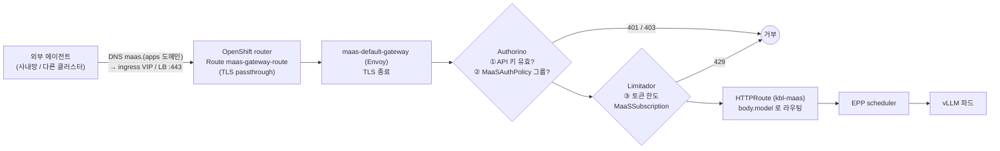
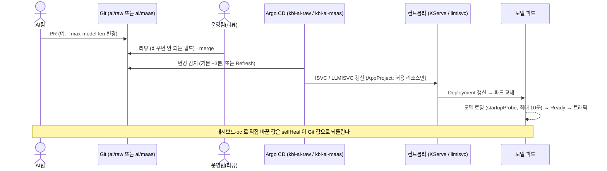

# KB Life AI 모델 서빙 GitOps — 운영팀·AI팀 안내

RHOAI 3.5 위에서 LLM 모델을 **두 가지 방식(KServe RawDeployment, llm-d + MaaS)으로 함께** 서빙하는 구조와,
운영팀(Ops)·AI팀·에이전트 개발팀이 각자 무엇을 하고, 모델을 어떻게 호출하며, 무엇을 바꾸면 배포된 모델에 어떤 일이 일어나는지 설명한다.

---

## 1. 한 장 요약

| 원칙 | 의미 | 왜 |
|---|---|---|
| **Git 이 유일한 변경 경로** | 사람은 Git 에 커밋하고, 클러스터 반영은 Argo CD 만 한다 | 변경 이력·리뷰·롤백이 Git 에 남는다. 손으로 바꾼 것은 Argo CD 가 되돌린다(selfHeal) |
| **폴더 = 책임** | `deploy/ops/` 는 운영팀, `deploy/ai/` 는 AI팀 | 누가 무엇을 바꿀 수 있는지 폴더만 보면 안다 |
| **이중 가드** | Argo CD AppProject 가 AI팀 폴더의 허용 리소스를 제한 + 클러스터 RBAC 는 AI팀에 조회만 | AI팀이 네트워크·권한·런타임을 바꿀 수 없다 |
| **두 서빙 경로, 용도로 구분** | **Raw**: 클러스터 안 에이전트 전용, SA 토큰 / **MaaS**: 클러스터 안팎, API 키 + 토큰 한도 | 내부 호출은 단순·저지연으로, 사용자·외부 호출은 사용량 통제와 함께 |
| **이름·digest 고정** | 런타임 `vllm-<등급>-<버전>`, 이미지·모델은 `@sha256:` | 무엇이 떠 있는지 정확히 식별, 검사한 이미지 그대로 배포 |
| **모델 접근은 정책으로** | Raw: 호출자 등록(`ops/consumers`) / MaaS: 그룹별 구독·인가(`ops/maas-policy`) | "누가 어떤 모델을 얼마나" 를 운영팀이 Git 으로 관리 |

---

## 2. 구조



### 폴더

```
deploy/
├── ai/                         AI팀
│   ├── raw/                    KServe InferenceService (RawDeployment, 토큰 인증)  → ns kbl-models
│   ├── maas/                   llm-d LLMInferenceService (MaaS 로 노출)          → ns kbl-maas
│   └── CATALOG.md              에이전트 개발자용 Raw 모델 목록 (scripts/model-catalog.py 로 생성)
├── ops/                        운영팀
│   ├── gitops/                 Argo CD AppProject · app-of-apps (apps/)
│   ├── platform/               클러스터 범위: Group(사용자), RBAC, HardwareProfile
│   ├── kbl-models/             Raw 네임스페이스: 격리(ANP·EgressFirewall·NetworkPolicy), RBAC, ServingRuntime, 호출 Role
│   ├── consumers/              Raw 호출자(에이전트 네임스페이스) 등록 — 호출자 하나 = 파일 하나
│   ├── kbl-maas/               MaaS 네임스페이스: 격리, RBAC, vLLM 런타임(LLMInferenceServiceConfig), MaaS 게시(MaaSModelRef)
│   ├── maas-policy/            MaaS 인가(MaaSAuthPolicy)·토큰 한도(MaaSSubscription)
│   ├── mig/                    GPU MIG 구성 (비활성, 구조만)
│   └── network-isolation/      격리 설명·검증 스크립트
├── examples/                   에이전트팀용 호출 예시 (동기화 안 함)
├── LABELS-ANNOTATIONS.md       라벨·annotation 출처
└── kbl-ai-gitops.md            이 문서
```

### Argo CD 앱 (app-of-apps: `kbl-root` → `ops/gitops/apps/`)

| 앱 | wave | 프로젝트 | 경로 | 동기화 | PoC 상태 |
|---|---|---|---|---|---|
| `kbl-ops-platform` | 0 | kbl-ops | `ops/platform` | 수동 (클러스터 범위) | 활성 |
| `kbl-ops-mig` | 0 | kbl-ops | `ops/mig` | 수동 | 비활성(주석) |
| `kbl-ops-kbl-models` | 1 | kbl-ops | `ops/kbl-models` | 자동, selfHeal, prune 끔 | 활성 |
| `kbl-ops-kbl-maas` | 1 | kbl-ops | `ops/kbl-maas` | 자동, selfHeal, prune 끔 | 활성 |
| `kbl-ops-consumers` | 1 | kbl-ops | `ops/consumers` | 자동, selfHeal, prune 끔 | 활성 |
| `kbl-ai-raw` | 2 | kbl-ai | `ai/raw` | 자동, selfHeal, **prune 켬** (파일 삭제 = 모델 내림) | 활성 |
| `kbl-ai-maas` | 2 | kbl-ai | `ai/maas` | 자동, selfHeal, **prune 켬** | 비활성(GPU 1장) |
| `kbl-ops-maas-policy` | 3 | kbl-ops | `ops/maas-policy` | 자동, selfHeal, prune 켬 | 활성 (대상 모델이 없어 `Failed`) |

---

## 3. 역할 분담

| | 운영팀 (Ops) | AI팀 | 에이전트 개발팀 |
|---|---|---|---|
| Git | `deploy/ops/` | `deploy/ai/raw/`, `deploy/ai/maas/` | (자기 앱 리포) |
| 하는 일 | 네임스페이스·격리, vLLM 런타임, 사용자·그룹, Raw 호출자 등록, MaaS 게시·인가·토큰 한도, GPU quota | 모델 배포·파라미터 조정 | 모델 호출 |
| 클러스터 권한 | 모델 네임스페이스 admin, 격리 정책 조회 (변경은 Git) | 모델 네임스페이스 **조회만** | 자기 네임스페이스 |
| RHOAI 대시보드 | 관리자 (Auth `adminGroups`) | 사용자 (Auth `allowedGroups`) | MaaS 사용자는 Gen AI studio(API 키) |
| Argo CD | kbl-ops 앱 전체 | kbl-ai 앱 조회·Sync | — |
| 레지스트리(Nexus) | `vllm-*` push, `models-validated` push(승인) | `models-community` push | — |

AI팀은 클러스터에서 모델을 직접 수정할 수 없다 (PoC 확인: `patch inferenceservice` → 거부). 바꾸려면 Git 에 커밋한다.

---

## 4. 두 서빙 방식을 함께 쓰기

| | **Raw** (KServe InferenceService) | **MaaS** (llm-d LLMInferenceService) |
|---|---|---|
| 용도 | 클러스터 **안**의 에이전트·서비스가 직접 호출 | 사용자·외부 에이전트·여러 팀 공용. 사용량 통제 필요 |
| Git (AI팀) | `ai/raw/<모델>.yaml` | `ai/maas/<모델>.yaml` |
| 네임스페이스 | `kbl-models` | `kbl-maas` |
| vLLM 런타임 (Ops) | `ServingRuntime` `ops/kbl-models/runtimes/vllm-ga-3-5-2.yaml` | `LLMInferenceServiceConfig` `ops/kbl-maas/runtimes/vllm-ga-3-5-2.yaml` (같은 이미지 digest) |
| 호출 주소 | `https://<모델>-predictor.kbl-models.svc:8443/v1` | `https://maas.<apps 도메인>/v1` |
| 인증 | Kubernetes SA 토큰 (kube-rbac-proxy) | MaaS API 키 `sk-oai-…` (Authorino) |
| 인가 | `ops/consumers/<ns>.yaml` → Role `model-caller` | `ops/maas-policy/authpolicy-*.yaml` (그룹) |
| 사용량 제한 | 없음 | `ops/maas-policy/subscription-*.yaml` 토큰 한도 (사용자별) |
| 클러스터 밖 호출 | 불가 (Route 없음) | 가능 |
| 근거 | 대시보드에 "Legacy deployment" 로 표시되지만 지원 (Release notes RHOAIENG-85220), 토큰 인증: Deploying models §2.9 | MaaS 는 LLMInferenceService 만 지원 (Govern LLM access with MaaS §1.10) |

**같은 모델을 두 방식으로 함께 서빙할 수 있다.** `ai/raw/` 와 `ai/maas/` 에 각각 파일을 두면 서로 다른 네임스페이스에 별도 파드로 뜬다
(GPU 를 각각 쓴다). 같은 모델 이미지·같은 vLLM 이미지를 쓰므로 응답은 같고, 호출 경로·인증·통제만 다르다.

| 이런 경우 | 선택 |
|---|---|
| 클러스터 안 에이전트가 지연 없이 내부 호출 | Raw |
| 사람(개발자·분석가)·외부 시스템이 쓰고 사용량을 제한해야 | MaaS |
| 팀별 할당량·사용량 집계가 필요 | MaaS |
| 둘 다 | 둘 다 배포 (GPU 2배) |

---

## 5. 네트워크

### 5.1 모델 네임스페이스에서 열려 있는 것 / 막혀 있는 것

#### `kbl-models` (Raw)

모델 파드(라벨 `serving.kserve.io/inferenceservice` 가 있는 파드)에 적용. 4개 계층이 겹친다.

| 계층 | 파일 | 누가 바꿀 수 있나 |
|---|---|---|
| AdminNetworkPolicy (클러스터 범위, NetworkPolicy 보다 먼저 평가) | `ops/kbl-models/20-adminnetworkpolicy.yaml` | cluster-admin(=Git) 만 |
| EgressFirewall (네임스페이스 전체, 클러스터 밖) | `ops/kbl-models/21-egressfirewall.yaml` | cluster-admin(=Git) 만 |
| NetworkPolicy | `ops/kbl-models/31·32·33-*.yaml`, `network/allow-*.yaml` | Git |
| 파드 SA | `ops/kbl-models/30-serviceaccount.yaml` (토큰은 인증 프록시용) | Git |

**들어오는 트래픽 (ingress)**

| 출발 | 포트 | 결과 | 비고 |
|---|---|---|---|
| 라벨 `kbl.io/model-consumer=true` 네임스페이스 | **8443** (kube-rbac-proxy, https) | ✅ | 토큰 검증 후 vLLM 으로 |
| 같은 라벨 네임스페이스 | 8080 (vLLM 직결, `<모델>-metrics` Service) | ❌ | 열면 토큰 없이 우회 호출됨 (PoC 확인 후 차단) |
| `openshift-user-workload-monitoring` | 8080 | ✅ | 메트릭 수집 |
| 같은 네임스페이스의 모델이 아닌 파드 (Ops 점검용) | 8080, 8443 | ✅ | |
| 그 외 모든 네임스페이스, 클러스터 밖 | 전부 | ❌ | Route 없음 (외부 노출 금지 규칙) |
| kubelet 프로브, `oc port-forward` | — | 영향 없음 | |

**나가는 트래픽 (egress)**

| 목적지 | 포트 | 결과 | 비고 |
|---|---|---|---|
| DNS (`openshift-dns`) | 5353 | ✅ | ANP Allow |
| API 서버 (control-plane 노드) | 6443 | ✅ | 토큰 인증 프록시의 TokenReview/SubjectAccessReview. 노드 셀렉터라 master 3대도 자동 포함 |
| 허용 목록 대상 (예: `rag-system` vector-db) | 6333 | 목록에 있는 모델만 ✅ | ANP Pass + `network/allow-*.yaml` |
| 다른 네임스페이스, **같은 네임스페이스의 다른 모델** | 전부 | ❌ | ANP Deny (NetworkPolicy 로도 못 엶) |
| 클러스터 밖 (인터넷, 사내망) | 전부 | ❌ | EgressFirewall Deny |
| 같은 노드의 다른 포트 (예: 22) | — | ❌ | PoC 확인 |

모델 이미지(ModelCar)·vLLM 이미지는 **노드(kubelet)** 가 받으므로 파드 egress 가 필요 없다.

#### `kbl-maas` (MaaS)

| 방향 | 출발/목적지 | 결과 | 파일 |
|---|---|---|---|
| ingress | `openshift-ingress` (MaaS gateway 파드) | ✅ | `ops/kbl-maas/30-networkpolicy.yaml` |
| ingress | 같은 네임스페이스 (EPP scheduler → vLLM) | ✅ | |
| ingress | `openshift-user-workload-monitoring` | ✅ | |
| ingress | 그 외 (에이전트 네임스페이스 포함) | ❌ | **MaaS 모델은 반드시 gateway 를 거쳐 호출** (인증·한도 우회 불가) |
| egress | vLLM 파드 → DNS | ✅ | |
| egress | vLLM 파드 → 그 외 | ❌ | |
| egress | EPP scheduler → API 서버 등 | 제한 없음 | EPP 는 API 서버를 조회해야 함 |
| — | ANP / EgressFirewall | 아직 없음 | llm-d 트래픽 경로 확인 후 추가 검토 (1차 구성) |

네임스페이스 라벨 `maas.opendatahub.io/gateway-access=true` 가 있어야 MaaS gateway 가 이 네임스페이스의 HTTPRoute 를 받는다 (`ops/kbl-maas/00-namespace.yaml`).

### 5.2 클러스터 안의 에이전트 앱이 호출할 때



| | ① Raw 모델 호출 | ② MaaS 모델 호출 (클러스터 안에서) |
|---|---|---|
| 주소 | `https://<모델>-predictor.kbl-models.svc:8443/v1` | `https://maas.<apps 도메인>/v1` |
| 운영팀 사전 작업 | `ops/consumers/<에이전트 ns>.yaml` (ns 라벨 + SA + RoleBinding) | 사용자 그룹에 `MaaSSubscription` + `MaaSAuthPolicy` |
| 에이전트 쪽 준비 | 파드 `serviceAccountName: <등록된 SA>` | API 키 (Gen AI studio → API keys) 를 Secret 으로 |
| 인증 헤더 | `Authorization: Bearer $(cat /var/run/secrets/kubernetes.io/serviceaccount/token)` | `Authorization: Bearer sk-oai-…` |
| TLS | OpenShift service CA (ConfigMap `openshift-service-ca.crt`, 모든 ns 에 자동 생성) | router 인증서 (사내 CA) |
| `model` 값 | `<ISVC 이름>` (예: `qwen3-4b-instruct`) | `/v1/models` 의 id: `publishers/<ns>/models/<model.name>` |
| 에이전트 ns 가 egress 를 막고 있으면 | `kbl-models` **8443** 허용 | **ingress VIP**:443 을 `ipBlock` 으로 허용 (router 가 hostNetwork 라 네임스페이스 셀렉터로 안 잡힘, PoC 확인) |
| 제약 | 등록된 SA 만, `kbl-models` 의 모든 Raw 모델 호출 가능 (모델별 제한 없음), 사용량 제한 없음 | 사용자별 토큰 한도, 키는 발급 시점 그룹 기억 |
| 검증 | PoC 확인: 토큰 없음 401 / 등록 SA 200 / 미등록 SA 403 / 8080 우회 차단 | PoC 확인: 클러스터 안 Job 에서 200 (egress 정책 적용 상태) |

예시 매니페스트: [examples/agent-client.yaml](examples/agent-client.yaml) (egress NetworkPolicy, API 키 Secret, 두 경로 호출 Job), Python: [examples/README.md](examples/README.md)

### 5.3 클러스터 밖의 에이전트가 MaaS gateway 를 거쳐 호출할 때



| 필요한 것 | 누가 | 비고 |
|---|---|---|
| `maas.<apps 도메인>` DNS 해석 | 사내 DNS | `*.apps` 와일드카드 |
| 외부 → ingress VIP(또는 LB) **443** 방화벽 허용 | 네트워크팀 | 클러스터로 들어오는 경로는 이것 하나 |
| router 인증서를 신뢰 (사내 CA) | 에이전트팀 | Route 는 passthrough, 인증서는 gateway 의 `router-certs-default` |
| 사용자(또는 서비스 계정 역할의 사용자)가 그룹에 속함 | 운영팀 | KB Life: AD 그룹 |
| 그룹에 `MaaSSubscription` + `MaaSAuthPolicy` | 운영팀 | 둘 중 하나만 있으면 403/429 |
| API 키 | 사용자 | 대시보드 Gen AI studio → API keys, 또는 maas-api (`/maas-api/v1/api-keys`, OpenShift 로그인 토큰으로 발급 — PoC 확인) |
| 모델 id | — | `GET /v1/models` |

```bash
curl https://maas.<apps 도메인>/v1/chat/completions \
  -H "Authorization: Bearer sk-oai-..." -H 'Content-Type: application/json' \
  -d '{"model":"publishers/kbl-maas/models/qwen3-4b-instruct","messages":[{"role":"user","content":"안녕"}],"max_tokens":100}'
```

- 경로 방식도 된다: `https://maas.<도메인>/<네임스페이스>/<모델>/v1/chat/completions`
- 응답 `usage.total_tokens`(입력+출력)가 사용자별 한도에 합산된다
- Raw 모델은 클러스터 밖에서 호출할 수 없다. 외부에서 써야 하는 모델은 MaaS 로 배포한다

---

## 6. AI팀이 바꾸면 배포된 모델에 일어나는 일

### 6.1 공통 흐름



### 6.2 Raw (`ai/raw/<모델>.yaml` → `kbl-models`)

| AI팀 변경 | 배포된 모델에 일어나는 일 | 호출자 영향 |
|---|---|---|
| `args` (`--max-model-len`, `--tool-call-parser` …), `env` | **파드 재기동**. `deploymentStrategy: Recreate` 라 기존 파드를 먼저 내리고 새 파드 로딩 (PoC 확인: 16384 → 12288) | 로딩 동안(수십 초~수 분) **호출 불가** |
| `resources` (cpu/memory/gpu) | 파드 재기동 (위와 같음). quota·노드 여유가 없으면 새 파드 Pending → **모델 중단 상태 지속** | 중단 |
| `storageUri` (모델 이미지 digest 교체) | 파드 재기동, 노드가 새 ModelCar 이미지 pull 후 로딩 | 중단, 응답 품질 변화 |
| `runtime` (예: `vllm-ga-3-5-2` → 새 버전) | 파드 재기동, 새 vLLM 이미지 | 중단, vLLM 동작 차이 가능 |
| `minReplicas`/`maxReplicas` | 파드 추가·제거 (기존 파드 유지) | 없음 (줄일 때 그 파드의 진행 중 요청만) |
| HW profile annotation | webhook 이 tolerations 등을 다시 넣음 → 파드 재기동 | 중단 |
| `serving.kserve.io/stop: "true"` | 파드 삭제, ISVC 유지 | 호출 불가 |
| `security.opendatahub.io/enable-auth` 끄기 | 프록시 제거, Service 가 8443 → 8080 으로 바뀜 | **에이전트 호출 불가** (8080 은 막혀 있음) — 금지 |
| 라벨·annotation (display-name 등) | 파드로 전파되는 라벨이면 재기동될 수 있음 (추정) | 가능성 있음 |
| 파일 삭제 | prune 으로 ISVC 삭제 → 모델 내려감 | 호출 불가 |
| 마지막 파일 삭제 | Argo 안전장치로 자동 삭제 안 됨 → 운영팀 수동 Sync | — |

GPU 가 넉넉하면 `deploymentStrategy` 를 RollingUpdate 로 바꿔 무중단(새 파드 Ready 후 기존 파드 종료)으로 할 수 있다. 대신 교체 동안 GPU 가 2배 필요하다.

### 6.3 MaaS (`ai/maas/<모델>.yaml` → `kbl-maas`)

| AI팀 변경 | 배포된 모델에 일어나는 일 | 호출자 영향 |
|---|---|---|
| env `VLLM_ADDITIONAL_ARGS`, `resources`, `model.uri` | llmisvc 컨트롤러가 `<모델>-kserve` Deployment 갱신 → **vLLM 파드 교체** (교체 방식은 컨트롤러 기본값 — 3.5 미확인. GPU 가 남지 않으면 새 파드 Pending 가능) | 교체 동안 지연·실패 가능 |
| `replicas` | vLLM 파드 추가·제거, EPP 가 새 파드로 분배 | 없음 |
| `model.name` | OpenAI API 모델 이름이 바뀜 → 호출자의 `model` 값(`publishers/<ns>/models/<name>`)이 바뀜 (추정) | **호출자 수정 필요** — 운영팀·에이전트팀과 협의 |
| `serving.kserve.io/stop: "true"` | vLLM 파드 삭제 (llm-d §6.4) | 호출 실패 |
| 파일 삭제 | LLMISVC 삭제. 운영팀의 MaaSModelRef·Subscription·AuthPolicy 는 남아 `Failed` (PoC 확인) | 호출 실패 |
| `baseRefs`·`router.gateway`·`image`·`enable-auth` | — (AI팀이 바꾸지 않음. 리뷰에서 거절) | — |

### 6.4 운영팀 변경이 모델에 주는 영향 (참고)

| 운영팀 변경 | 영향 |
|---|---|
| ServingRuntime / LLMInferenceServiceConfig **수정** | 그 런타임을 쓰는 **모든 모델 파드 재기동** (추정) → 런타임은 수정하지 말고 새 이름(`vllm-ga-<새 버전>`)으로 **추가**, 모델별로 AI팀이 옮긴다 |
| `MaaSSubscription` 한도 변경 | 재기동 없음. Kuadrant TokenRateLimitPolicy 갱신, 약 1분 내 반영 (PoC 확인: 2000 → 20000) |
| `MaaSAuthPolicy` 그룹 변경 | 재기동 없음. Authorino 캐시(60초) 후 반영 |
| `MaaSModelRef` 삭제 | MaaS 에서 모델 비공개 (파드는 계속 실행) |
| `ops/consumers/<ns>.yaml` 삭제 + RoleBinding 삭제 | 그 에이전트의 Raw 호출 즉시 403 (프록시가 매 요청 권한 확인) |
| NetworkPolicy/ANP/EgressFirewall | 재기동 없음, 즉시 반영 |
| MIG 구성 | 노드 GPU 재분할 → 해당 노드 모델 중단 (`ops/mig/README.md` 절차) |

---

## 7. 제약사항 요약

**호출**
- Raw: 토큰 인증 필수, 클러스터 안에서만, 등록된 호출자만. 호출 권한은 `kbl-models` 의 모든 Raw 모델 단위
- MaaS: API 키 필수, 사용자별 토큰 한도(입력+출력), 키는 발급 시점 그룹 기억 → 그룹에서 빼면 키 revoke (Govern LLM access with MaaS §1.16.3), Subscription 삭제 시 그 키 모두 무효
- MaaS 모델 파드는 gateway 외 경로로 호출할 수 없다
- 모델 파드는 외부·다른 네임스페이스·다른 모델로 나갈 수 없다 (Raw: API 서버 6443 만 예외). 모델이 다른 서비스를 불러야 하면 운영팀에 요청

**배포**
- 이미지·모델은 digest(`@sha256:`)로만
- 네임스페이스 GPU quota 를 넘으면 Pending. 같은 모델을 Raw·MaaS 로 함께 띄우면 GPU 2배
- AI팀 폴더에 허용 안 된 리소스(ConfigMap, MaaSSubscription 등)를 커밋하면 그 앱 **동기화 전체가 멈춤** (`not permitted in project kbl-ai`) → 파일 삭제로 해제
- 폴더의 마지막 모델 파일을 지우면 자동 삭제 거부 ("auto-sync will wipe out all resources") → 운영팀 수동 Sync

**운영팀 작업 시**
- Git 에서 뺀 리소스를 직접 지울 때는 **앱이 새 커밋으로 Synced 된 뒤** 지운다. 먼저 지우면 selfHeal 이 다시 만든다 (PoC 에서 두 번 발생)
- `prune: false` 앱(`kbl-ops-*`)은 파일을 지워도 리소스가 남는다 → 확인 후 직접 삭제
- Raw ↔ MaaS 전환 시 GPU 가 부족하면 기존 쪽을 먼저 내려야 새 쪽이 뜬다

---

## 8. 요청 절차 (누가 · 어느 파일)

| 요청 | 요청자 → 처리 | 파일 |
|---|---|---|
| 새 vLLM 버전 | AI → Ops | Raw: `ops/kbl-models/runtimes/` / MaaS: `ops/kbl-maas/runtimes/` 에 새 파일 → AI 가 `runtime`/`baseRefs` 변경 |
| Raw 호출자(에이전트 ns) 등록 | 에이전트팀 → Ops | `ops/consumers/<ns>.yaml` |
| 모델 MaaS 공개 | AI → Ops | `ops/kbl-maas/maas/<모델>.yaml` + `ops/maas-policy/` (한 커밋) |
| 토큰 한도 변경 / 사용 그룹 추가 | 사용자·AI → Ops | `ops/maas-policy/subscription-*.yaml`, `authpolicy-*.yaml` |
| 사용자 추가 | → Ops | `ops/platform/groups.yaml` (KB Life: AD 그룹) |
| 모델이 다른 ns 서비스 호출 | AI → Ops | `ops/kbl-models/network/allow-*.yaml` + ANP `pass-*` 규칙 |
| GPU quota | AI → Ops | `ops/kbl-models/10-resourcequota.yaml`, `ops/kbl-maas/10-resourcequota.yaml` |
| MIG 구성 변경 | → Ops (유지보수) | `ops/mig/README.md` |

---

## 9. 응답 코드·문제 해결

| 증상 | Raw | MaaS |
|---|---|---|
| 401 | SA 토큰 없음/만료 | API 키 없음/만료/revoke |
| 403 | 호출자 미등록 (`ops/consumers`) | AuthPolicy 에 그룹 없음 |
| 404 | 경로 오류 | body `model` 이 `/v1/models` id 가 아님 |
| 429 | — | 토큰 한도 초과, 또는 Subscription 없음 |
| 400 `invalid_subscription` (키 발급) | — | 사용자 그룹에 Subscription 없음 |
| 연결 실패 | ns 라벨 없음, 8080 으로 호출, 에이전트 ns egress | 에이전트 ns egress 가 ingress VIP 를 막음, 외부 방화벽 |
| TLS 오류 | service CA 미지정 | 사내 CA 미신뢰 |
| 파드 Pending | GPU 부족/quota, Recreate 중 | GPU 부족/quota |
| ImagePullBackOff | digest 가 레지스트리에 없음, pull secret | 같음 |

---

## 10. KB Life 환경에 적용할 때 바꿀 값

| 항목 | PoC 값 | KB Life |
|---|---|---|
| 서빙 방식 | Raw 만 활성 (GPU 1장) | Raw·MaaS 둘 다: `21-kbl-ai-maas.yaml`, `ops/kbl-maas/maas/*.yaml` 주석 해제 |
| 레지스트리 | registry.redhat.io, quay.io 직접 | Nexus `vllm-*`, `models-*` repo 의 digest, SA `imagePullSecrets: nexus-pull` |
| 사용자·그룹 | htpasswd `ops`/`ai` + `ops/platform/groups.yaml` | AD 그룹 → OpenShift Group 동기화 (LDAP group sync) |
| 대시보드 접근 | Auth CR `adminGroups`/`allowedGroups` | 같은 방식, AD 그룹명 |
| API 서버 egress | control-plane 노드 셀렉터 | 그대로 (master 3대 자동 포함) |
| ingress VIP (에이전트 egress 예시) | `192.168.31.230` | KB Life ingress VIP |
| MaaS 호스트 | `maas.apps.rhoai-35.edwin.home` | `maas.<KB Life apps 도메인>` |
| Git | GitHub, 브랜치 `test/rhoai-35-home` | 사내 Git — `repoURL`·`targetRevision`·AppProject `sourceRepos` |

---

## 11. 관련 문서

- [README.md](README.md) — deploy 개요
- [ai/README.md](ai/README.md) — AI팀 작업 규칙 (Raw·MaaS)
- [ops/README.md](ops/README.md) — 운영팀 작업 (설치, 런타임 추가, MaaS 운영, 호출자 등록)
- [ops/consumers/README.md](ops/consumers/README.md) — Raw 호출자 등록·해지
- [ops/network-isolation/README.md](ops/network-isolation/README.md) — 네트워크 격리
- [ops/mig/README.md](ops/mig/README.md) — MIG 구성·변경 절차
- [examples/README.md](examples/README.md) — 에이전트 호출 예시
- [LABELS-ANNOTATIONS.md](LABELS-ANNOTATIONS.md) — 라벨·annotation 근거
- `docs/maas-guide.md` (로컬, git 제외) — 대시보드로 MaaS 배포·정책 적용·테스트
- RHOAI 3.5: *Govern LLM access with Models-as-a-Service*, *Deploy models using distributed inference with llm-d*, *Deploying models*
