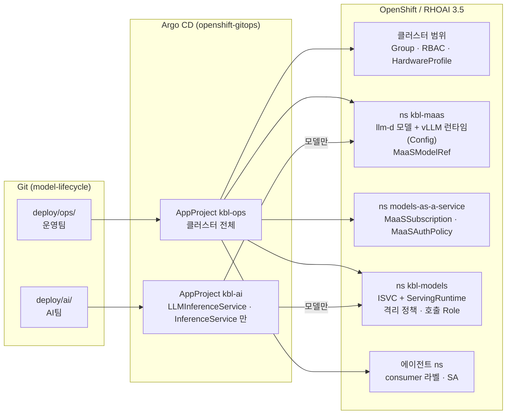
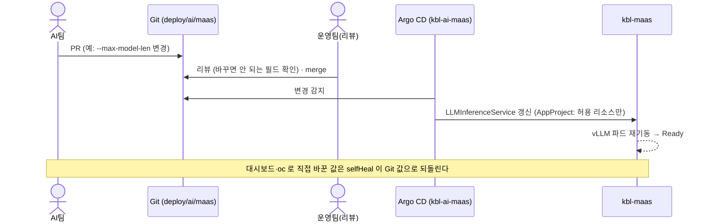
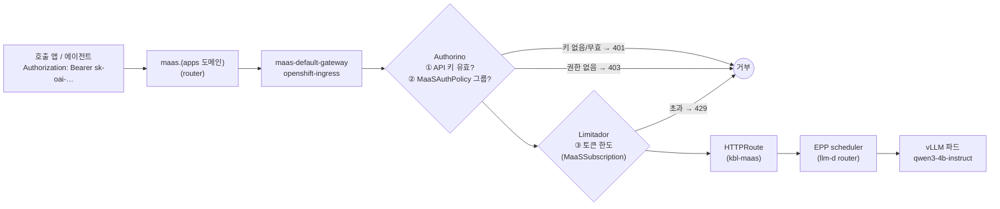
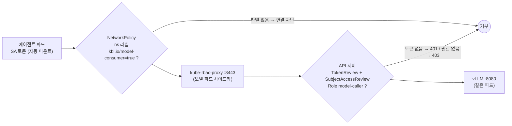

# KB Life AI 모델 서빙 GitOps — 운영팀·AI팀 안내

RHOAI 3.5 위에서 LLM 을 서빙하는 방식과, **운영팀(Ops)·AI팀·에이전트 개발팀이 각자 무엇을 하고 어떻게 모델을 호출하는지**를 설명한다.
PoC(클러스터 rhoai-35, 브랜치 `test/rhoai-35-home`)에서 검증한 내용이다. 표기: **PoC 확인** = 실제 동작 확인, **3.5 미확인** = RHOAI 3.5 문서에 근거 없음.

---

## 1. 한 장 요약

| 원칙 | 의미 | 왜 |
|---|---|---|
| **Git 이 유일한 변경 경로** | 사람은 Git 에 커밋하고, 클러스터 반영은 Argo CD 만 한다 | 변경 이력·리뷰·롤백이 Git 에 남는다. 손으로 바꾼 것은 Argo CD 가 되돌린다(selfHeal) |
| **폴더 = 책임** | `deploy/ops/` 는 운영팀, `deploy/ai/` 는 AI팀 | 누가 무엇을 바꿀 수 있는지 폴더만 보면 안다. 나중에 리포를 나눠도 구조 그대로 |
| **이중 가드** | Argo CD AppProject 가 AI팀 폴더의 허용 리소스를 제한 + 클러스터 RBAC 는 AI팀에 조회만 | AI팀이 실수나 의도로 네트워크·권한·런타임을 바꿀 수 없다 |
| **이름·digest 고정** | 런타임 `vllm-<등급>-<버전>`, 이미지·모델은 `@sha256:` | 무엇이 떠 있는지 정확히 식별하고, 검사한 이미지 그대로 배포한다 |
| **모델 접근은 정책으로** | MaaS: 그룹별 구독·토큰 한도 / ISVC: 호출자 등록 + 토큰 | "누가 어떤 모델을 얼마나" 를 운영팀이 Git 으로 관리한다 |

---

## 2. 구조



### 폴더

```
deploy/
├── ai/                         AI팀
│   ├── maas/                   llm-d LLMInferenceService (MaaS 로 노출)      ← 기본
│   ├── raw/                    KServe InferenceService (토큰 인증)           ← 보관, 앱 비활성
│   └── CATALOG.md              에이전트 개발자용 모델 목록 (scripts/model-catalog.py 로 생성)
├── ops/                        운영팀
│   ├── gitops/                 Argo CD AppProject · app-of-apps (apps/)
│   ├── platform/               클러스터 범위: Group(사용자), RBAC, HardwareProfile
│   ├── kbl-maas/               llm-d 모델 네임스페이스: 격리, RBAC, vLLM 런타임(LLMInferenceServiceConfig), MaaS 게시
│   ├── maas-policy/            MaaS 인가(MaaSAuthPolicy)·토큰 한도(MaaSSubscription)
│   ├── kbl-models/             ISVC 모델 네임스페이스: 격리(ANP·EgressFirewall·NetworkPolicy), RBAC, ServingRuntime, 호출 Role
│   ├── consumers/              ISVC 호출자(에이전트 네임스페이스) 등록 — 호출자 하나 = 파일 하나
│   ├── mig/                    GPU MIG 구성 (비활성, 구조만)
│   └── network-isolation/      격리 설명·검증 스크립트
├── examples/                   에이전트팀용 호출 예시 (동기화 안 함)
├── LABELS-ANNOTATIONS.md       라벨·annotation 출처
└── kbl-ai-gitops.md            이 문서
```

### Argo CD 앱 (app-of-apps: `kbl-root` → `ops/gitops/apps/`)

| 앱 | wave | 프로젝트 | 경로 | 자동 동기화 |
|---|---|---|---|---|
| `kbl-ops-platform` | 0 | kbl-ops | `ops/platform` | ❌ 수동 (클러스터 범위) |
| `kbl-ops-mig` | 0 | kbl-ops | `ops/mig` | **비활성**(파일 주석) |
| `kbl-ops-kbl-models` | 1 | kbl-ops | `ops/kbl-models` | ✅ selfHeal, prune 끔 |
| `kbl-ops-kbl-maas` | 1 | kbl-ops | `ops/kbl-maas` | ✅ selfHeal, prune 끔 |
| `kbl-ops-consumers` | 1 | kbl-ops | `ops/consumers` | ✅ selfHeal, prune 끔 |
| `kbl-ai-maas` | 2 | kbl-ai | `ai/maas` | **비활성**(파일 주석, GPU 1장 PoC). 켜면 selfHeal, **prune 켬** |
| `kbl-ai-raw` | 2 | kbl-ai | `ai/raw` | ✅ selfHeal, **prune 켬** (파일 삭제 = 모델 내림) |
| `kbl-ops-maas-policy` | 3 | kbl-ops | `ops/maas-policy` | ✅ selfHeal, prune 켬 |

---

## 3. 역할 분담

| | 운영팀 (Ops) | AI팀 | 에이전트 개발팀 |
|---|---|---|---|
| Git | `deploy/ops/` | `deploy/ai/` | (자기 앱 리포) |
| 하는 일 | 네임스페이스·격리, vLLM 런타임, 사용자·그룹, MaaS 게시·인가·토큰 한도, 호출자 등록, GPU quota | 모델 배포·파라미터 조정(args, resources, replica) | 모델 호출 |
| 클러스터 권한 | 모델 네임스페이스 admin, 격리 정책 조회 (변경은 Git) | 모델 네임스페이스 **조회만** | 자기 네임스페이스 |
| RHOAI 대시보드 | 관리자 (Auth `adminGroups`) | 사용자 (Auth `allowedGroups`) | — (MaaS 사용자라면 Gen AI studio) |
| Argo CD | kbl-ops 앱 전체 | kbl-ai 앱 조회·Sync | — |
| 레지스트리(Nexus) | `vllm-*` push, `models-validated` push(승인) | `models-community` push | — |

AI팀은 클러스터에서 모델을 직접 수정할 수 없다(PoC 확인: `patch inferenceservice` → 거부). 바꾸려면 Git 에 커밋한다.

---

## 4. 서빙 방식 두 가지

| | **A. llm-d + MaaS** (기본) | **B. KServe InferenceService** (보관) |
|---|---|---|
| 리소스 | `LLMInferenceService` (`ai/maas/`) | `InferenceService` + `ServingRuntime` (`ai/raw/`) |
| 네임스페이스 | `kbl-maas` | `kbl-models` |
| 호출 주소 | `https://maas.<apps 도메인>/v1` (클러스터 밖에서도) | `https://<모델>-predictor.kbl-models.svc:8443/v1` (클러스터 안) |
| 인증 | MaaS API 키 (`sk-oai-…`) | Kubernetes SA 토큰 |
| 인가 | `MaaSAuthPolicy` (그룹) | `consumers/<ns>.yaml` → Role `model-caller` |
| 사용량 제한 | `MaaSSubscription` 토큰 한도 (사용자별) | 없음 |
| vLLM 런타임 | `LLMInferenceServiceConfig vllm-ga-3-5-2` | `ServingRuntime vllm-ga-3-5-2` |
| 비고 | RHOAI 3.5 에서 MaaS 는 LLMInferenceService 만 지원 (Govern…MaaS §1.10) | 대시보드에 "Legacy deployment" 로 표시되지만 지원됨 (Release notes RHOAIENG-85220) |

> **현재 상태 (GPU 1장 PoC)**: **B** 로 서빙 중이다. A 는 `ops/gitops/apps/21-kbl-ai-maas.yaml` 과 `ops/kbl-maas/maas/qwen3-4b-instruct.yaml`(MaaSModelRef)를 주석 처리해 꺼 두었다. A 로 되돌리려면 두 파일 주석을 해제하고 22 를 주석 처리한다.

생성형 모델의 목표 구성은 **A** 다. B 는 MaaS 를 거치지 않는 내부 전용 호출용이다.

---

## 5. AI팀: 모델 배포·변경 흐름



| AI팀이 바꿀 수 있는 것 (`ai/maas/<모델>.yaml`) | 바꾸지 않는 것 (운영팀에 요청) |
|---|---|
| `model.uri` (레지스트리의 digest), `model.name` | `baseRefs` (vLLM 런타임 — 새 버전은 운영팀이 추가) |
| `replicas`, `resources` (GPU quota 범위) | `router.gateway` (MaaS gateway) |
| env `VLLM_ADDITIONAL_ARGS` (`--max-model-len`, `--tool-call-parser` 등) | `image`, `security.opendatahub.io/enable-auth` |
| `openshift.io/display-name`, `description` | MaaS 게시·권한·한도 (`ops/kbl-maas/maas/`, `ops/maas-policy/`) |

모델 추가 = `ai/maas/` 에 파일 추가(AI팀) **+** MaaS 게시·구독·인가(운영팀, 한 커밋). 게시만 하고 정책이 없으면 아무도 호출할 수 없다.

---

## 6. 모델 호출 흐름

### A. MaaS (llm-d)



- 요청 body 의 `model` 로 라우팅한다. 값은 `/v1/models` 의 id: **`publishers/<네임스페이스>/models/<model.name>`** (PoC 확인 — 짧은 이름이면 404)
- 경로 방식도 된다: `https://maas.<도메인>/<네임스페이스>/<모델>/v1/chat/completions`
- 사용 토큰(입력+출력)이 사용자별로 합산되어 한도에 반영된다

### B. InferenceService (토큰 인증)



- 8080(vLLM 직결)은 에이전트 네임스페이스에 열지 않는다. 열면 토큰 없이 우회 호출된다 (PoC 확인 후 차단)
- 모델 파드는 API 서버(control-plane 노드 6443)로만 나갈 수 있고 외부·다른 네임스페이스로는 못 나간다

---

## 7. 모델을 호출할 때 필요한 것

### A. MaaS

| 필요한 것 | 누가 | 어떻게 |
|---|---|---|
| 사용자가 그룹에 속함 (예: `kbl-ai-developers`) | 운영팀 | `ops/platform/groups.yaml` (KB Life: AD 그룹 동기화) |
| 그룹에 대한 **MaaSSubscription + MaaSAuthPolicy** (항상 짝) | 운영팀 | `ops/maas-policy/` |
| API 키 `sk-oai-…` | 사용자 | 대시보드 Gen AI studio → API keys (또는 maas-api) |
| 모델 id, 엔드포인트 | — | `GET https://maas.<도메인>/v1/models` |
| (에이전트 ns 가 egress 제한 시) ingress VIP:443 허용 | 에이전트팀 | `examples/agent-client.yaml` |

```bash
curl https://maas.<도메인>/v1/chat/completions \
  -H "Authorization: Bearer sk-oai-..." -H 'Content-Type: application/json' \
  -d '{"model":"publishers/kbl-maas/models/qwen3-4b-instruct","messages":[{"role":"user","content":"안녕"}]}'
```

### B. InferenceService

| 필요한 것 | 누가 | 어떻게 |
|---|---|---|
| 호출자 등록 (ns 라벨 + SA + RoleBinding) | 운영팀 | `ops/consumers/<에이전트 ns>.yaml` 한 파일 |
| 파드를 등록된 SA 로 실행 | 에이전트팀 | `serviceAccountName: agent` |
| 토큰·CA | 자동 | 토큰 `/var/run/secrets/kubernetes.io/serviceaccount/token`, CA ConfigMap `openshift-service-ca.crt` |
| (egress 제한 시) `kbl-models:8443` 허용 | 에이전트팀 | `examples/agent-client.yaml` |

```python
import httpx
from openai import OpenAI
SA = "/var/run/secrets/kubernetes.io/serviceaccount"
c = OpenAI(base_url="https://qwen3-4b-instruct-predictor.kbl-models.svc:8443/v1",
           api_key=open(f"{SA}/token").read(),                      # 토큰은 갱신되므로 매번 읽는다
           http_client=httpx.Client(verify="/etc/service-ca/service-ca.crt"))
c.chat.completions.create(model="qwen3-4b-instruct", messages=[{"role": "user", "content": "안녕"}])
```

전체 예시: [examples/agent-client.yaml](examples/agent-client.yaml), [examples/README.md](examples/README.md)

---

## 8. 제약사항

**호출**
- MaaS 토큰 한도는 **사용자별**, 요청 수가 아니라 **토큰 수**(입력+출력) 기준이다
- MaaS API 키는 **발급 시점의 그룹 멤버십**을 기억한다. 사용자를 그룹에서 빼면 키를 revoke 해야 접근이 끊긴다 (Govern…MaaS §1.16.3)
- Subscription 을 지우면 그에 묶인 API 키가 모두 무효화된다
- ISVC 는 **토큰 인증 필수**. 인증을 끄면 에이전트가 호출할 수 없다 (8443 만 열려 있음)
- ISVC 호출 권한(Role `model-caller`)은 `kbl-models` 의 **모든 모델**에 적용된다. 특정 모델만 막으려면 네임스페이스를 분리한다
- 모델 파드는 외부 인터넷·다른 네임스페이스·다른 모델로 나갈 수 없다. 모델이 다른 서비스(vector DB 등)를 불러야 하면 운영팀에 허용을 요청한다

**배포**
- 이미지·모델은 digest(`@sha256:`)로만 지정한다. 태그는 쓰지 않는다
- 네임스페이스 GPU quota 를 넘는 replica/resources 는 Pending 이 된다
- AI팀 폴더에 허용되지 않은 리소스(ConfigMap, MaaSSubscription 등)를 커밋하면 **그 앱의 동기화 전체가 멈춘다** (`not permitted in project kbl-ai`). 해당 파일을 지우면 풀린다
- 폴더의 마지막 모델 파일을 지우면 Argo CD 가 안전장치로 자동 삭제를 거부한다("auto-sync will wipe out all resources") → 운영팀이 수동 Sync
- GPU 가 남지 않는 환경에서 롤링 업데이트는 새 파드가 Pending 이 된다 → `deploymentStrategy: Recreate` (짧은 중단)

**운영팀 작업 시**
- Git 에서 뺀 리소스를 클러스터에서 직접 지울 때는 **앱이 새 커밋으로 Synced 된 것을 먼저 확인**한다. 먼저 지우면 selfHeal 이 다시 만든다 (PoC 에서 두 번 발생)
- `prune: false` 앱(`kbl-ops-*`)은 파일을 지워도 리소스가 남는다 → 확인 후 직접 삭제

---

## 9. 요청 절차 (누가 · 어느 파일)

| 요청 | 요청자 → 처리 | 파일 |
|---|---|---|
| 새 vLLM 버전 | AI → Ops | `ops/kbl-maas/runtimes/vllm-<등급>-<버전>.yaml` 추가 → AI 가 `baseRefs` 변경 |
| 모델 MaaS 공개 | AI → Ops | `ops/kbl-maas/maas/<모델>.yaml` + `ops/maas-policy/` (한 커밋) |
| 토큰 한도 변경 / 사용 그룹 추가 | 사용자·AI → Ops | `ops/maas-policy/subscription-*.yaml`, `authpolicy-*.yaml` |
| 사용자 추가 | → Ops | `ops/platform/groups.yaml` (KB Life: AD 그룹) |
| ISVC 호출자(에이전트 ns) 등록 | 에이전트팀 → Ops | `ops/consumers/<ns>.yaml` |
| 모델이 다른 ns 서비스 호출 | AI → Ops | `ops/kbl-models/network/allow-*.yaml` + ANP `pass-*` 규칙 |
| GPU quota | AI → Ops | `ops/kbl-*/10-resourcequota.yaml` |
| MIG 구성 변경 | → Ops (유지보수 작업) | `ops/mig/README.md` 절차 |

---

## 10. 응답 코드·문제 해결

| 증상 | 원인 | 조치 |
|---|---|---|
| 401 | 키·토큰 없음/만료/revoke | 키 재발급, 토큰 확인 |
| 403 | MaaS: AuthPolicy 에 그룹 없음 / ISVC: 호출자 미등록 | 운영팀에 등록 요청 |
| 404 (MaaS) | body `model` 이 짧은 이름 | `/v1/models` 의 id 사용 |
| 429 | 토큰 한도 초과, 또는 Subscription 없음 | 잠시 후 재시도 / 한도 증액 요청 |
| 400 `invalid_subscription` (키 발급 시) | 사용자 그룹에 Subscription 없음 | 운영팀에 구독 요청 |
| 연결 실패 (000) | 네트워크: consumer 라벨 없음, 에이전트 ns egress 제한 | 호출자 등록, egress 허용 |
| 파드 Pending | GPU 부족/quota | quota·노드 여유 확인 |
| ImagePullBackOff | digest 가 레지스트리에 없음, pull secret | 이미지 반입·digest 확인 |

---

## 11. KB Life 환경에 적용할 때 바꿀 값

| 항목 | PoC 값 | KB Life |
|---|---|---|
| 레지스트리 | registry.redhat.io, quay.io (직접) | Nexus `vllm-*`, `models-*` repo 의 digest, SA `imagePullSecrets: nexus-pull` |
| 사용자·그룹 | htpasswd `ops`/`ai` + `ops/platform/groups.yaml` | AD 그룹을 OpenShift Group 으로 동기화(LDAP group sync) |
| 대시보드 접근 | Auth CR (`adminGroups`/`allowedGroups`) | 같은 방식, AD 그룹명 |
| API 서버 egress | control-plane 노드 셀렉터 | 그대로 (master 3대도 자동 포함) |
| 에이전트 예시 egress | ingress VIP `192.168.31.230` | KB Life ingress VIP |
| MaaS 호스트 | `maas.apps.rhoai-35.edwin.home` | `maas.<KB Life apps 도메인>` |
| Git | GitHub, 브랜치 `test/rhoai-35-home` | 사내 Git, `repoURL`·`targetRevision`·AppProject `sourceRepos` |
| 리포 분리 | 한 리포 두 폴더 | 필요 시 `ops/`, `ai/` 를 각 리포로 (Argo `repoURL`/`path` 만 변경) |

---

## 12. 관련 문서

- [README.md](README.md) — deploy 개요
- [ai/README.md](ai/README.md) — AI팀 작업 규칙 (ISVC·LLMISVC)
- [ops/README.md](ops/README.md) — 운영팀 작업 (설치, 런타임 추가, MaaS 운영, 호출자 등록)
- [ops/consumers/README.md](ops/consumers/README.md) — 호출자 등록·해지
- [ops/network-isolation/README.md](ops/network-isolation/README.md) — 네트워크 격리
- [ops/mig/README.md](ops/mig/README.md) — MIG 구성·변경 절차
- [LABELS-ANNOTATIONS.md](LABELS-ANNOTATIONS.md) — 라벨·annotation 근거
- `docs/maas-guide.md` (로컬, git 제외) — 대시보드로 MaaS 배포·정책 적용·테스트
- RHOAI 3.5: *Govern LLM access with Models-as-a-Service*, *Deploy models using distributed inference with llm-d*, *Deploying models*
